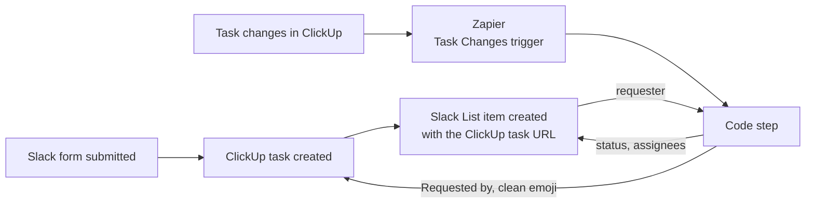

# Slack ⇄ ClickUp Request Sync (case study)

Two-way sync between a Slack List request tracker and the ClickUp tasks behind it. The team submits and follows requests in Slack, and the work is managed in ClickUp.

## The problem

Requests for the operations team used to arrive across several Slack channels and DMs, with no single place to see them all.

A Slack form fixed that: every request now creates a ClickUp task and a card in a Slack List tracker. But it created a new problem. As soon as the work moved in ClickUp, the Slack tracker went stale: requesters couldn't see whether their request had been picked up, who had it, or whether it was done.

Slack Lists and ClickUp have no native sync, and Zapier has no ready-made actions for Slack Lists.

## How it works

1. The Slack form workflow creates the ClickUp task, then the Slack List item, and stores the task URL on the item.
2. A Zap triggers on any task change in the list and runs one code step.
3. The code finds the matching item, updates what changed on each side, and leaves a short log in Zap History, including anyone it couldn't match.

## What syncs

| Field | Direction | Rule |
|---|---|---|
| Status | ClickUp → Slack | Same status name on both sides |
| Assignees | ClickUp → Slack | Matched by email, with a manual map for people whose emails differ |
| Requested by | Slack → ClickUp | The form submitter fills the ClickUp field, only if it's empty |
| Priority emoji | Cleaned in ClickUp | `:large_blue_circle: Normal` becomes 🔵 Normal |

Priority and due date are deliberately not synced. Requesters can't set them accurately, so they stay as context in the task description.

## Design decisions

- **Match by task URL, not title.** The ClickUp list holds plenty of tasks that didn't come from the form, and titles collide or get renamed. The URL stored on the Slack item gives an exact match, and tasks without an item are skipped.
- **Identical status names instead of a mapping table.** The Slack statuses were renamed to match ClickUp exactly. Nothing to maintain, as long as a rename on one side is repeated on the other.
- **ClickUp is the source of truth.** Status and assignees only flow from ClickUp to Slack. The one thing that flows back is the requester, because only Slack knows who submitted.
- **A small dedicated Slack app.** Zapier's Slack connection can't get List permissions, so a private app holds them and the Zap calls the Slack API directly.
- **No loops.** The code's own edits to the task trigger the Zap once more. That run finds nothing to change and stops, and Requested by is only written when empty.
- **Keep the emoji where people like them.** The team wanted colored priority emoji in the Slack dropdown, so instead of removing them, the code converts the text codes the form pastes into ClickUp.

## Known limits

- If ClickUp fires before the Slack item exists, Requested by fills on the task's next change, usually the assignment.
- Every change to any task in the list costs one Zapier task, including tasks that didn't come from the form.
- New people whose ClickUp and Slack emails differ need to be added to the manual map.

## Stack

Slack Workflow Builder · Slack Lists API · ClickUp API · Zapier (ClickUp trigger + Code by Zapier)
